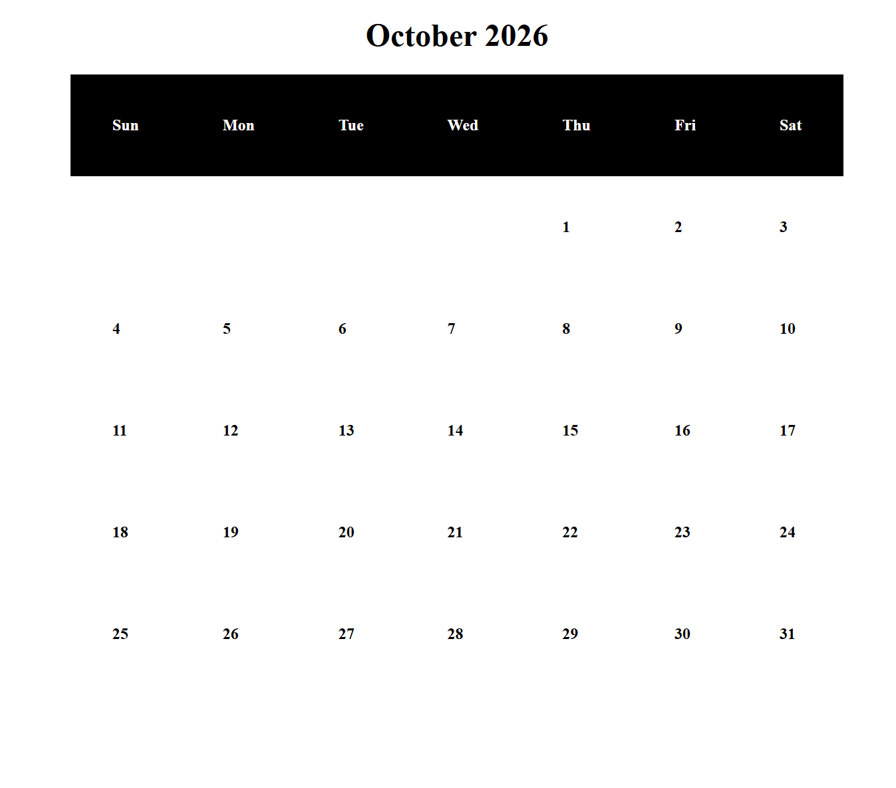

## Calendar View 
#### **Authors:** Maggie Bragg, Matthew Allen

This feature allows Schedulers to view all of their tasks planned for any given month or day.
When an individual day is selected, each of the Scheduler’s tasks for the specified day is
displayed including their start and end times.

### Monthly Calendar View 

#### Previous Button 

Clicking on the "Previous" button shall display the Monthly Calendar View for the preceding month's days. If the current month is January, it shall display the preceding year's Monthly Calendar View for December.

#### Next Button 

Clicking on the "Next" button shall display the Monthly Calendar View for the succeeding month's days. If the current month is December, it shall display the succeeding year's Monthly Calendar View for January.

### Daily Calendar View 

Clicking on any day in the Monthly Calendar View shall display that day's Daily Calendar View.

Note: Insert Screenshot of Daily Calendar View

#### Add Task Button 

Clicking on the "Add Task" button will bring you to Gold Star's Task Management Page. Details about this page can be found [here](task-management.md).  

#### Edit Task Button 

Clicking on the pencil icon on an existing task will bring you to Gold Star's Task Management Page. Details about this page can be found [here](task-management.md).

#### Delete Task Button 

Clicking on the trash icon on an existing task will open a confirmation window that will ask "Are you sure you want to delete this task?". Clicking "Yes" will delete the task from your calendar. Clicking "No" will keep the task as is. 

[Return to Homepage](../) &nbsp; &nbsp; &nbsp; [Return to Feature List](index.md) &nbsp; &nbsp; &nbsp; [[-> Next Feature]](task-management.md)